<div align="center">
  
  <h1>DayFlit</h1>
  <p><b>The Native Spatial Desktop Workspace for Windows</b></p>
  <p><i>Tasks, Bidirectional Edgeless Canvas, Automated Life Architecture, OS Reality Timeline, and an iOS Dynamic Island—engineered in Rust & Tauri v2 inside a 3.9 MB native binary.</i></p>

  <p>
    <a href="https://github.com/sidhu1512/dayflit/releases/download/v1.0.0/DayFlit_1.0.0_x64-setup.exe"></a>
    <a href="https://sidhu1512.github.io/dayflit/"></a>
    
    
    
    
  </p>
</div>

<picture>
  <source media="(prefers-color-scheme: dark)" srcset="docs/showcase/hero_dark.png">
  <source media="(prefers-color-scheme: light)" srcset="docs/showcase/hero_light.png">
  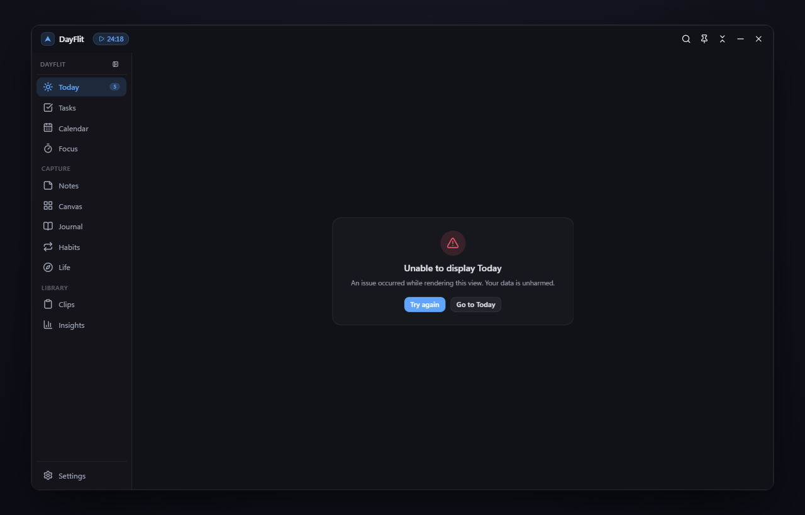
</picture>

<p align="center">
  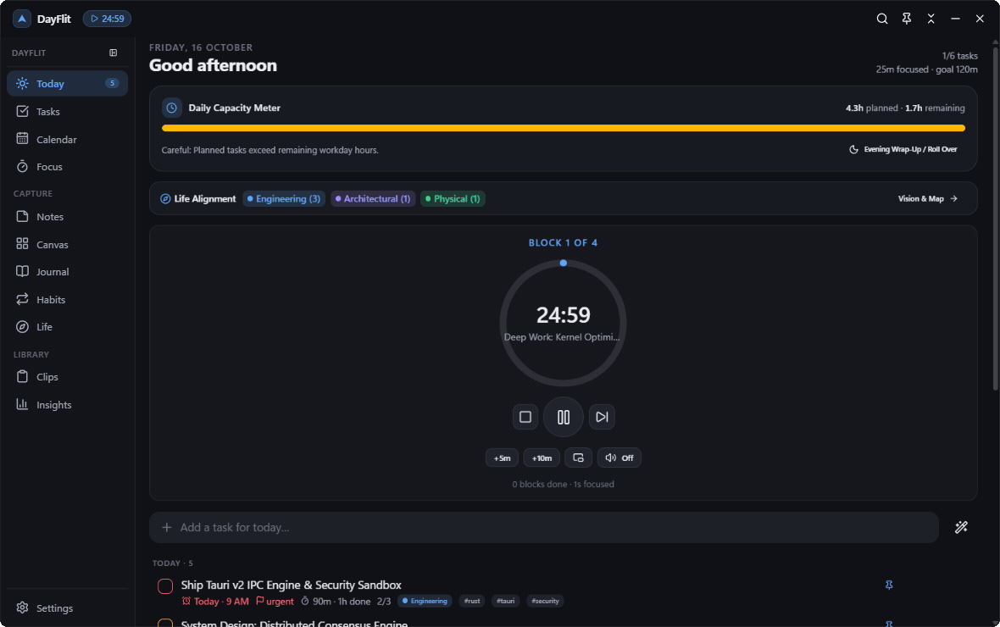
</p>

---

## Why DayFlit? — Not Another Todo App

Most desktop productivity apps are bloated Electron wrappers that consume 500 MB of RAM just to display a text list, force your thoughts into rigid linear outlines, and rely on subjective manual check-ins that disconnect your schedule from real daily activity.

**DayFlit is engineered differently.** Built in Rust and Tauri v2, DayFlit runs in a **3.94 MB native executable** with a sub-40 MB RAM footprint. It treats notes, tasks, ideas, and habits as physical spatial objects that flow seamlessly across an infinite canvas, anchor directly to your screen with an iOS Dynamic Island, and automatically compare your planned daily schedule against real Win32 foreground OS activity.

| Feature / Architecture | **DayFlit** | Things 3 | Notion | Obsidian | Sunsama | Dropover / Alcove |
| :--- | :---: | :---: | :---: | :---: | :---: | :---: |
| **Native Executable Footprint** | **3.94 MB (Rust)** | ~25 MB (macOS only) | 250 MB+ (Electron) | 220 MB+ (Electron) | 300 MB+ (Electron) | ~40 MB |
| **Idle Memory (RAM)** | **~35 MB** | ~40 MB | 450–700 MB | 250–500 MB | 500–900 MB | ~60 MB |
| **Bidirectional Doc ↔ Edgeless Canvas** | **Yes (JSON Canvas 1.0)** | No | No | Plugin only (not 2-way) | No | No |
| **Living iOS Dynamic Island (`pip`)** | **Yes (Bilateral Springs)** | No | No | No | Mini widget only | Floating shelf only |
| **Dropover Magnetic Stash Shelf** | **Yes (Files, URLs, Notes)** | No | No | No | No | Yes |
| **Win32 OS Reality Timeline** | **Yes (Automated)** | No | No | No | Manual only | No |
| **3-Mode Life Architecture & Wheel** | **Yes (Time-Machine)** | No | Database templates | Graph view only | No | No |
| **Raycast-Grade Instant Math Palette** | **Yes (`Ctrl+K` / `Alt+Shift+D`)** | No | Search only | Command palette | Search only | No |
| **100% Offline Local Atomic Storage** | **Yes (`.tmp → .bak → .zip`)** | Local-first | Cloud required | Local Markdown | Cloud required | Local |
| **Platform Availability** | **Windows 10 & 11** | macOS/iOS only | Web / Cross | Cross | Cross | macOS only |

---

## Downloads & Installation

DayFlit runs natively on 64-bit Windows 10 and Windows 11.

| Package | File | Size | Description |
| :--- | :--- | :--- | :--- |
| **Windows Installer** | [DayFlit_1.0.0_x64-setup.exe](https://github.com/sidhu1512/dayflit/releases/download/v1.0.0/DayFlit_1.0.0_x64-setup.exe) | **3.94 MB** | Standard NSIS installer with start menu shortcut and clean uninstaller |
| **Direct Portable Binary** | [dayflit.exe](https://github.com/sidhu1512/dayflit/releases/download/v1.0.0/dayflit.exe) | **13.4 MB** | Standalone uncompressed executable—zero installation required |

### Checksum Verification
```powershell
Get-FileHash -Algorithm SHA256 DayFlit_1.0.0_x64-setup.exe
# SHA-256: 4b8af810d245beaf605f51b450d40334da325413b0206da0b99928fcb421ecbe
```

---

## Visual Feature Showcase

### 1. Living iOS Dynamic Island & Dropover Stash Shelf

<p align="center">
  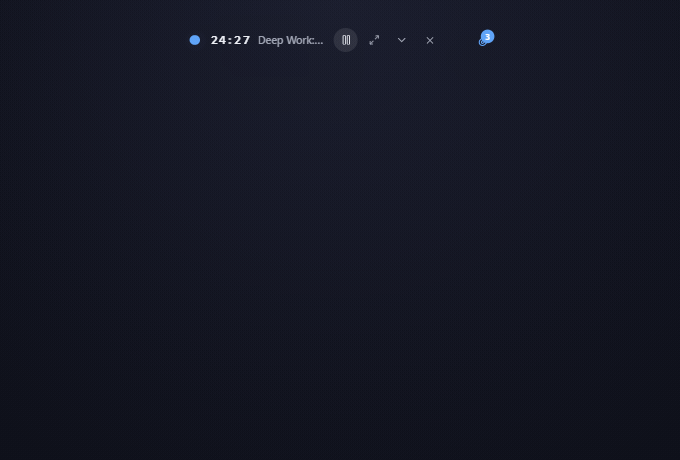
</p>

<table>
  <tr>
    <td width="50%" valign="top">
      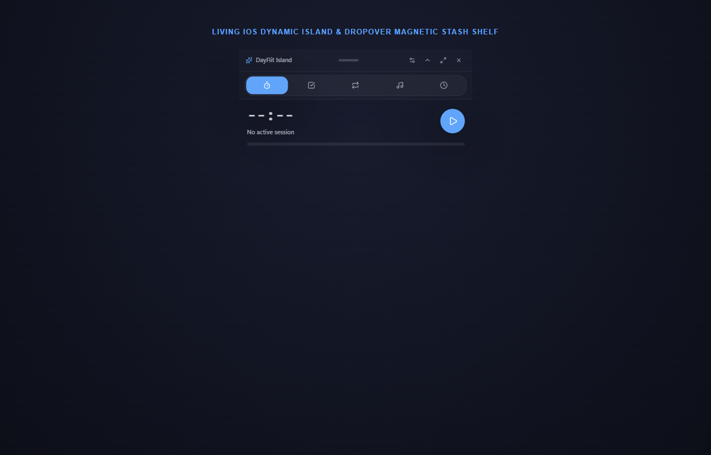
    </td>
    <td width="50%" valign="top">
      <h3>Desktop Notch Anchoring & Spring Physics</h3>
      <p>DayFlit brings an authentic <b>Apple-caliber Dynamic Island (<code>pip</code>)</b> to Windows. Anchored top-center to your display with microsecond Win32 top-center math, it smoothly floats above all desktop workflows.</p>
      <ul>
        <li><b>Bilateral Spring Expansion:</b> Morphs from a sleek, compact 48px capsule into an expansive Hover Peek Strip, and springs open into a full Spatial Bento Deck.</li>
        <li><b>Dropover Magnetic Stash Shelf:</b> Drag and drop images, project files, and URLs directly into the island to stash them for immediate use across apps.</li>
        <li><b>Rolling Odometer Digits:</b> Millisecond-precise focus timers with smooth vertical digit rolls, Pomodoro phase states, and ambient audio controls.</li>
        <li><b>Split-Island Satellite Orb:</b> Detaches floating status badges when multitasking.</li>
      </ul>
    </td>
  </tr>
</table>

---

### 2. Bidirectional Markdown Docs ↔ AFFiNE Edgeless Canvas

<p align="center">
  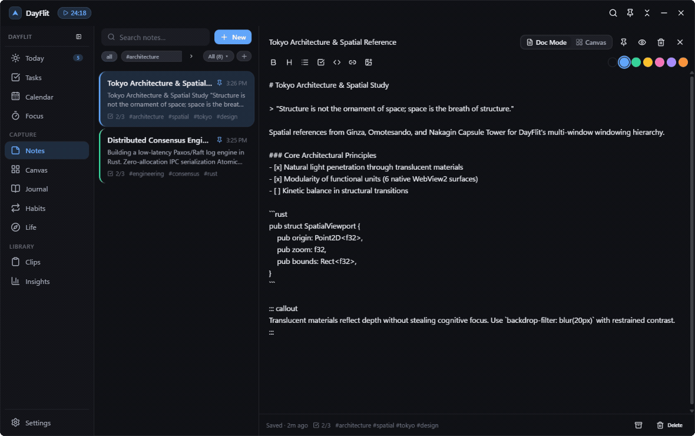
</p>

<table>
  <tr>
    <td width="50%" valign="top">
      <h3>AFFiNE-Style Freehand & Spatial Thinking</h3>
      <p>Documents are no longer trapped in static vertical walls. Write linear Markdown notes with checklists, syntax highlighting, and <code>/callout</code> containers, then click <b>Edgeless Canvas</b> to watch your blocks morph into spatial cards on an infinite dot-grid canvas.</p>
      <ul>
        <li><b>Live 2-Way Task & Note Cards:</b> Editing a task checkbox or note card on the canvas updates the core database immediately.</li>
        <li><b>Group Frame Containment:</b> Move, resize, and nest frames—all contained child cards move along cohesively.</li>
        <li><b>Magnetic 4-Port Bézier Connectors:</b> Drag directional arrows between cards with smart collision avoidance.</li>
        <li><b>Obsidian JSON Canvas 1.0:</b> 1-click import and export compatible with Obsidian and standard canvas tools.</li>
        <li><b>Live Embed Nodes:</b> Embed interactive Figma, Excalidraw, and web previews directly onto your whiteboard.</li>
      </ul>
    </td>
    <td width="50%" valign="top">
      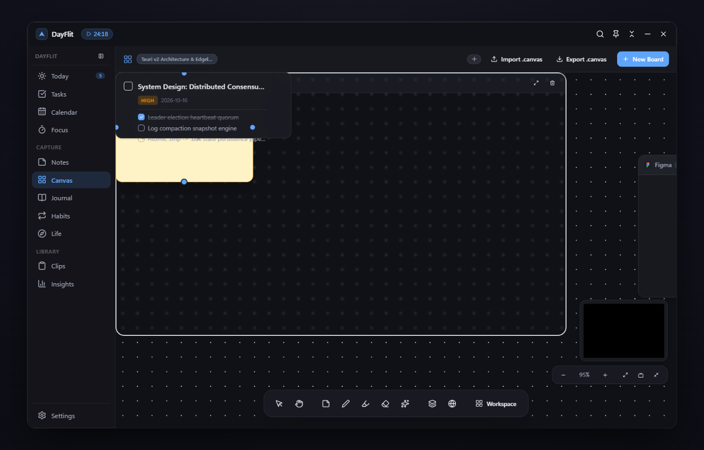
    </td>
  </tr>
</table>

---

### 3. 3-Mode Life Architecture: Studio, Time-Machine Wheel & Spatial Map

<p align="center">
  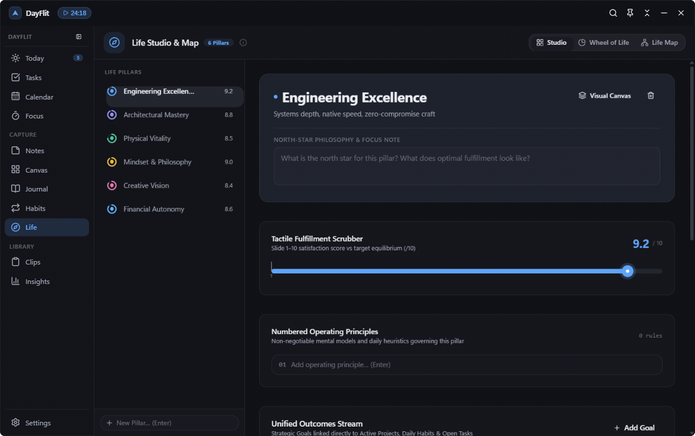
</p>

<table>
  <tr>
    <td width="50%" valign="top">
      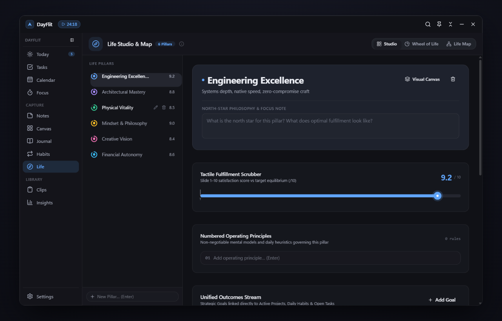
    </td>
    <td width="50%" valign="top">
      <h3>High-Level Vision Grounded in Daily Execution</h3>
      <p>DayFlit integrates your daily tasks and habits into an overarching life architecture across three distinct, deeply synchronized visualization modes:</p>
      <ul>
        <li><b>Editorial Life Studio:</b> Architect your core pillars, high-order goals, active projects, and personal principles in a clean typographic layout.</li>
        <li><b>Wheel of Life Radar with Time-Machine:</b> Direct-manipulation SVG radar chart. Scrub the historical Time-Machine slider to watch your past quarterly balance polygons morph over time.</li>
        <li><b>234-Wire Bézier Spatial Life Map:</b> An interactive node-graph network that illuminates full lineage paths from foundational life principles down to today's active tasks.</li>
      </ul>
    </td>
  </tr>
</table>

---

### 4. "Planned vs. Actual Reality" OS Timeline & Daily Chronicle

<p align="center">
  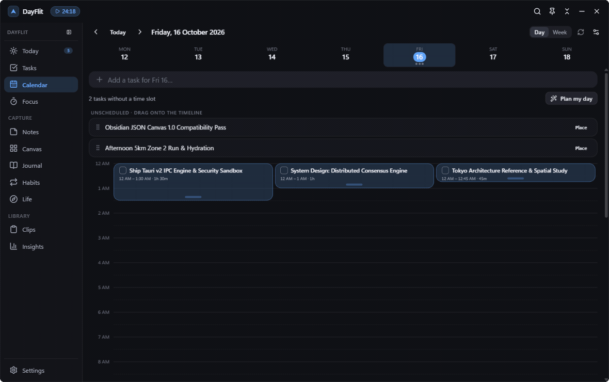
</p>

<table>
  <tr>
    <td width="50%" valign="top">
      <h3>Automated Win32 Foreground Tracking</h3>
      <p>Most time-trackers require tedious manual start/stop toggles. DayFlit features a native Rust foreground window tracker (<code>distraction.rs</code>) that monitors real application sessions locally without cloud inspection.</p>
      <ul>
        <li><b>Dual-Track Timeline:</b> Compare your planned calendar timebox blocks directly beside real foreground app activity (VS Code, Terminal, Figma, Chrome).</li>
        <li><b>Magnetic 15-Minute Timeboxing:</b> Drag unscheduled tasks directly onto the daily schedule with auto-snapping and duration resizing.</li>
        <li><b>Daily Chronicle:</b> Automatically synthesizes completed tasks, focus sessions, and active work sessions into structured Markdown entries in your private Journal.</li>
        <li><b>Pearson Behavioral Correlations:</b> Mathematical analysis of sleep, habit streaks, and focus metrics against mood ratings.</li>
      </ul>
    </td>
    <td width="50%" valign="top">
      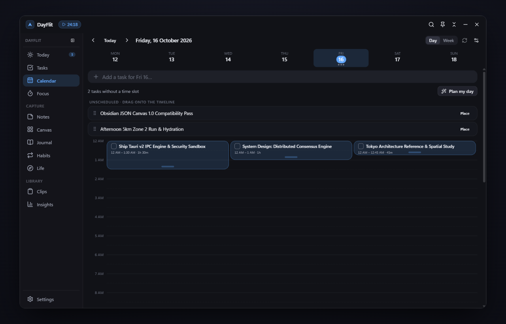
    </td>
  </tr>
</table>

---

### 5. Raycast Command Palette, `[[Wiki-Links]]` & Smart Object Cards

<table>
  <tr>
    <td width="50%" valign="top">
      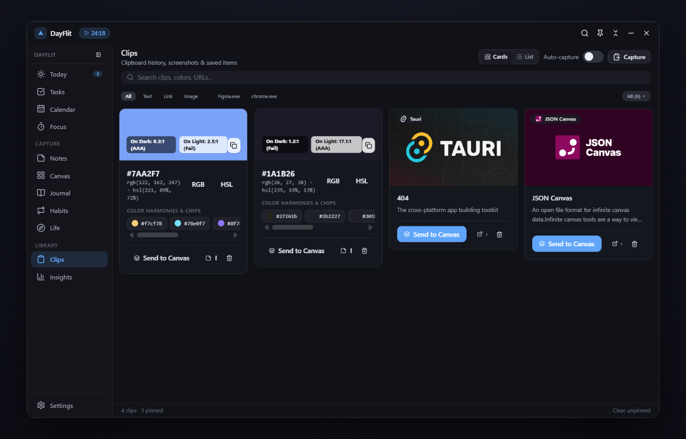
    </td>
    <td width="50%" valign="top">
      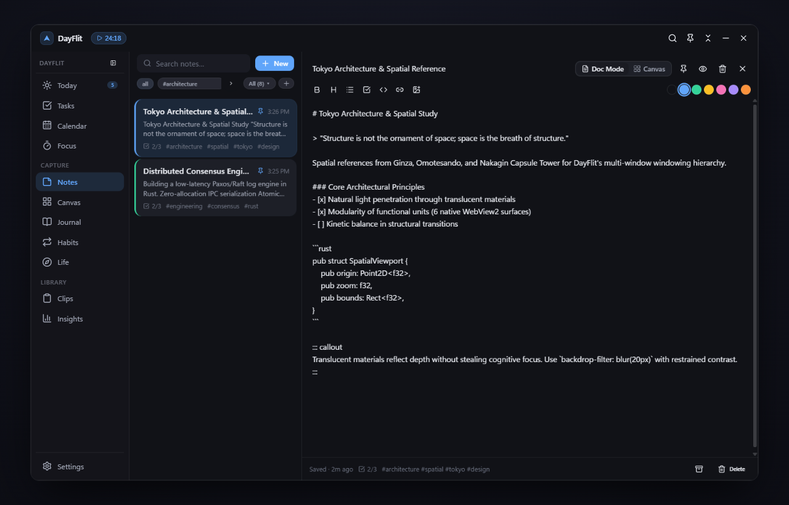
    </td>
  </tr>
</table>

- **Raycast-Grade Command Palette (`Ctrl+K` / `Alt+Shift+D`):** Global natural-language calculator (`15% of $4,800 + 32 * 12`), fuzzy omnisearch across tasks, notes, habits, and life goals, and quick-action slash commands (`/todo`, `/callout`, `/code`).
- **`[[Wiki-Links]]` & Automatic Backlinks:** Link concepts between notes and journal entries with auto-complete and bi-directional reference footers.
- **MyMind-Style Smart Object Cards:** Clipboard history (`Clips`) automatically classifies clipboard items into visual cards—detecting color codes with generated harmonic swatches, scraping rich OpenGraph web bookmark cards, and launching full-screen `<MediaLightbox />` previews.

---

## Systems Architecture & Hardened Security

DayFlit is engineered with an isolated multi-window architecture and strict local-first data integrity.

```
                           ┌────────────────────────────────────────┐
                           │      DayFlit Tauri v2 Native Core      │
                           │   (Win32 / Rust 2021 / 3.94 MB binary) │
                           └──────────────────┬─────────────────────┘
                                              │
       ┌────────────────────────┬─────────────┴──────────┬────────────────────────┐
       │                        │                        │                        │
┌──────▼──────┐          ┌──────▼──────┐          ┌──────▼──────┐          ┌──────▼──────┐
│ main window │          │  pip window │          │   palette   │          │ voice/bubble│
│  Workspace  │          │DynamicIsland│          │   Ctrl+K    │          │  Overlays   │
└──────┬──────┘          └──────┬──────┘          └──────┬──────┘          └──────┬──────┘
       │                        │                        │                        │
       └────────────────────────┼────────────────────────┴────────────────────────┘
                                │
               Authoritative IPC Event Bus (`sid://*`)
                                │
       ┌────────────────────────┴────────────────────────┐
       │                                                 │
┌──────▼─────────────────────────┐     ┌─────────────────▼────────────────┐
│  Atomic Persistence Engine     │     │  Local Security Perimeter        │
│  • .tmp atomic staging         │     │  • Zero cloud telemetry          │
│  • .bak automated snapshotting │     │  • SSRF DNS pre-resolution       │
│  • 1-Click .zip encrypted export│    │  • Zip-Slip & NTFS ADS protection│
└────────────────────────────────┘     └──────────────────────────────────┘
```

### Security Hardening
- **Zero Cloud Telemetry:** Operates 100% locally. No external telemetry, tracking, or cloud dependencies.
- **SSRF Defense:** Rust link scraper performs strict DNS pre-resolution to block private IPv4/IPv6 ranges (`127.0.0.1`, `10.0.0.0/8`, `192.168.0.0/16`, AWS IMDS `169.254.169.254`).
- **Path Sanitization:** ZIP export and attachment storage enforce strict filename normalization, guarding against Zip-Slip, Windows NTFS Alternate Data Streams (`:stream`), and DOS device paths (`CON`, `PRN`, `AUX`, `NUL`).
- **Atomic File Transactions:** All database saves write to `.tmp` first, flush buffers to disk, and atomically rename over the target file, with rolling automated `.bak` snapshot recovery.

---

## Keyboard Shortcuts

| Shortcut | Context | Action |
| :--- | :--- | :--- |
| `Ctrl+K` / `Alt+Shift+D` | Global | Open Raycast Command Palette / Quick Search & Calculator |
| `Alt+Shift+V` | Global | Open Floating Voice Memo Window |
| `Alt+Shift+C` | Global | Open Clipboard History (`Clips`) |
| `1` – `0` | In-App | Instant view switcher (Today, Tasks, Notes, Journal, Calendar, Focus, Habits, Life, Clips, Stats) |
| `Ctrl+N` | In-App | Quick Add Task |
| `Ctrl+Shift+N` | In-App | Create New Markdown Note |
| `Space + Drag` / Middle Click | Canvas | Pan infinite whiteboard at 60 FPS |
| `Wheel` | Canvas | Cursor-centered zoom (15% to 300%) |
| `S` | Canvas | Insert Sticky Note |
| `T` | Canvas | Insert Live Two-Way Task Card |
| `F` | Canvas | Create Grouping Frame |
| `Esc` | Overlays | Dismiss Command Palette, Lightbox, or Dialog |

---

## Building from Source

### Prerequisites
- [Node.js](https://nodejs.org/) (v20+ recommended)
- [Rust & Cargo](https://rustup.rs/) (v1.75+)
- Visual Studio Build Tools (C++ development workload)
- WebView2 Runtime (pre-installed on Windows 10/11)

### Development
```powershell
# Clone the repository
git clone https://github.com/sidhu1512/dayflit.git
cd dayflit

# Install dependencies
npm install

# Run Vitest test suite (266 tests)
npm test

# Run Rust unit tests (17 tests)
cargo test --manifest-path src-tauri/Cargo.toml

# Start development application
npm run dev
npm run tauri dev
```

### Production Build
```powershell
# Compile the production NSIS installer (3.94 MB)
npm run build
npm run tauri build
```

---

## License

DayFlit is released under the [MIT License](LICENSE).
Built with craft by [Sidhu](https://github.com/sidhu1512).
