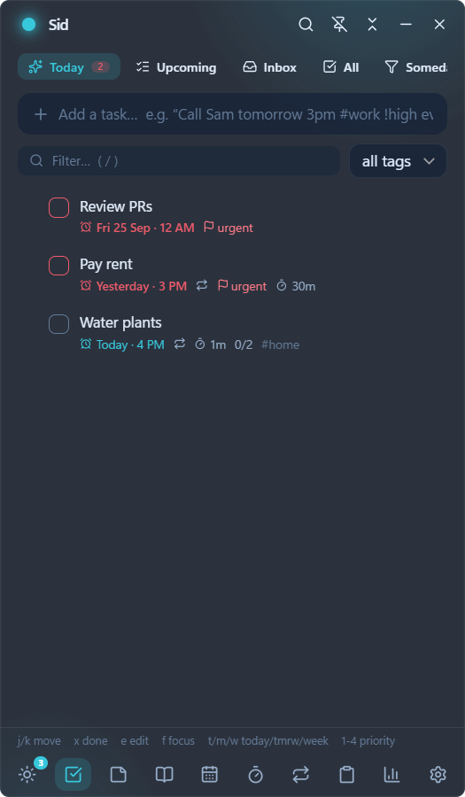
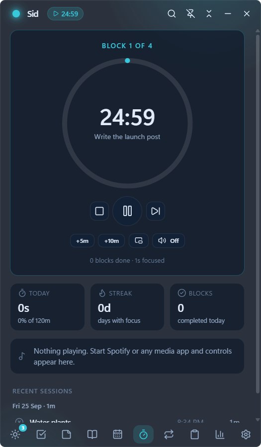
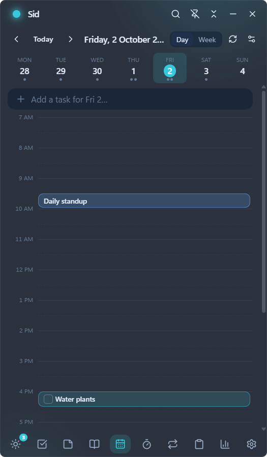
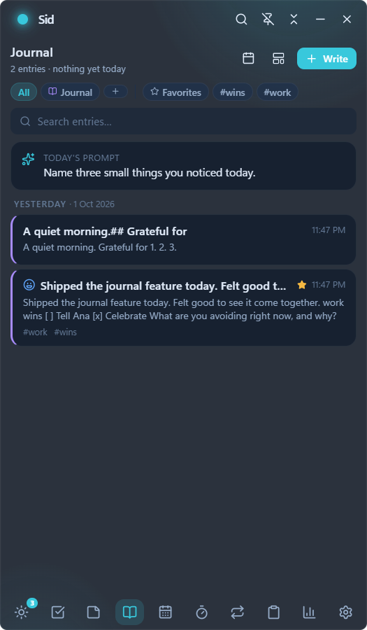
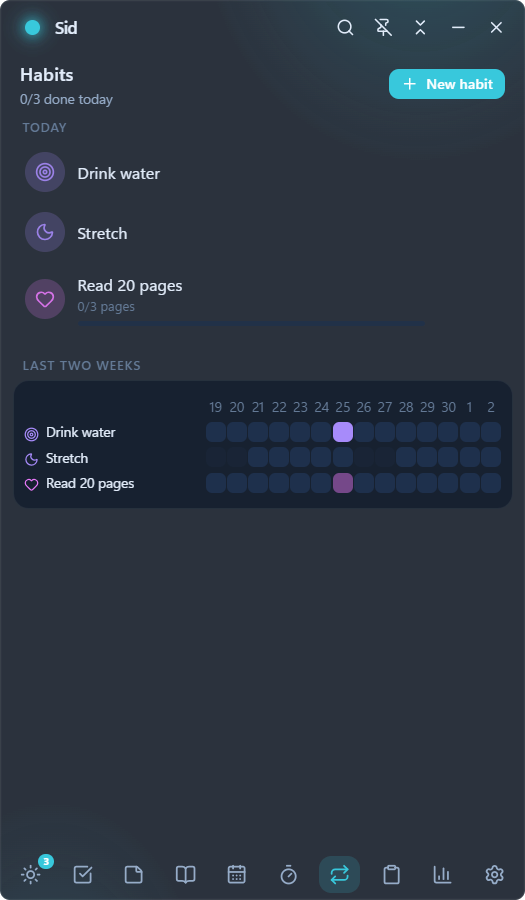
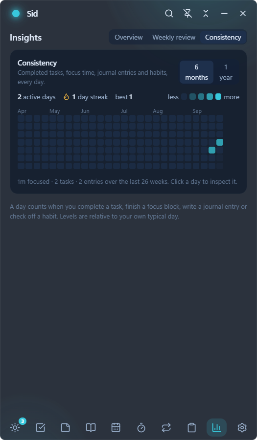

# Dayflit

[](https://sidhu1512.github.io/dayflit/)
[](https://sidhu1512.github.io/dayflit/)
[](https://github.com/sidhu1512/dayflit/releases/tag/v1.0.0)
[](https://github.com/sidhu1512/dayflit)
[](https://tauri.app)
[](LICENSE)

> A floating desktop productivity companion for Windows 10 and 11. Tasks, canvas boards, notes, focus sessions, habits, calendar timeboxing, clipboard capture, and media controls in one translucent, high-performance window that is always a keystroke away. 100% offline, local JSON storage, zero telemetry.

Website and Interactive Preview: [https://sidhu1512.github.io/dayflit/](https://sidhu1512.github.io/dayflit/)

---

## Downloads for Windows

Dayflit runs natively on Windows 10 and Windows 11 (64-bit).

| Package | Download Link | File Size | Description |
| :--- | :--- | :--- | :--- |
| **Windows Setup Installer** | [DayFlit_1.0.0_x64-setup.exe](https://github.com/sidhu1512/dayflit/releases/download/v1.0.0/DayFlit_1.0.0_x64-setup.exe) | 3.9 MB | Recommended installer with desktop and start menu shortcuts, automatic uninstall support |
| **Standalone Executable** | [dayflit.exe](https://github.com/sidhu1512/dayflit/releases/download/v1.0.0/dayflit.exe) | 13.4 MB | Portable single binary, no installation required, run from any folder or USB drive |

### Verification
- Version: `1.0.0`
- SHA-256 Checksum: `4b8af810d245beaf605f51b450d40334da325413b0206da0b99928fcb421ecbe`
- Release Tag: [v1.0.0](https://github.com/sidhu1512/dayflit/releases/tag/v1.0.0)

To verify the installer checksum in PowerShell:
```powershell
Get-FileHash -Algorithm SHA256 DayFlit_1.0.0_x64-setup.exe
```

---

## Interface Overview


Dayflit floats smoothly above your workspace. Tap `Alt+Space` to summon it, type naturally to capture tasks or notes, and hit `Escape` to send it back to the background or collapse it into a discrete floating bubble.

---

## Visual Tour and Feature Screenshots

### 1. Today View and Dynamic Island
Manage your daily agenda, active tasks, and continuous progress metrics. The dynamic island expands with physical spring motion to reveal active timers and contextual actions.

| Light Mode | Dark Mode |
| :---: | :---: |
|  |  |

---

### 2. Task Management and Subtasks
Capture items with natural language (`Call Sam tomorrow 3pm #work !urgent for 45m`). Break complex objectives into checkable subtasks with estimates and tags.

| Tasks Light | Tasks Dark |
| :---: | :---: |
|  |  |

---

### 3. Focus Sessions and Ambient Soundscapes
Rust-authoritative countdown and stopwatch engines that never drift or stall when windows are hidden. Includes ambient soundscapes (rain, forest, white noise) and Spotify media integration.

| Focus Setup | Focus Running |
| :---: | :---: |
|  |  |

---

### 4. Floating Picture-in-Picture (PiP) and Bubble Mode
Keep critical focus counters and task prompts visible while programming, writing, or designing. Collapses down to a tiny translucent bubble when full immersion is needed.

| Floating PiP Widget | Micro-Bubble Mode |
| :---: | :---: |
|  |  |

---

### 5. Calendar Timeboxing and Meeting Integration
Import any standard `.ics` calendar feed (Google Calendar, Microsoft Outlook, Apple iCloud). Dayflit detects meeting URLs for Zoom, Google Meet, Microsoft Teams, and Webex with one-click joining.

| Calendar Light | Calendar Dark |
| :---: | :---: |
|  |  |

---

### 6. Markdown Notes and Private Offline Journal
Distraction-free Markdown editor with code block syntax highlighting, checklists, tag indexing, and local image attachments. Private journal entries with mood rating (1-5), reflection prompts, and optional PIN security.

| Journal Light | Journal Dark |
| :---: | :---: |
|  |  |

---

### 7. Habits and Consistency Heatmap
Establish routines with flexible cadence scheduling (daily, specific weekdays, or weekly quotas). Track progress through 90-day visual heatmaps and streak counters.

| Habits Light | Habits Dark |
| :---: | :---: |
|  |  |

---

### 8. Global Command Palette and Voice Capture
Hit `Ctrl+K` or `Alt+Space` from any application to perform instant fuzzy search across all tasks, notes, journal entries, and commands. Hold `Alt+Shift+V` to record offline voice memos.

| Command Palette | Voice Recording |
| :---: | :---: |
|  |  |

---

### 9. Productivity Insights and Life Map
Evaluate week-over-week consistency, focus duration distribution, and an 8-dimension life balance assessment instrument.

| Insights Light | Insights Dark |
| :---: | :---: |
|  |  |

---

## Screen Recording and Interactive Demonstration

A complete interactive preview and animated showcase is accessible on the official website:
- **Interactive Web Preview:** [https://sidhu1512.github.io/dayflit/#screen-recording](https://sidhu1512.github.io/dayflit/#screen-recording)
- **Live Theme Switcher:** Test light and dark surfaces, typography scales, and acrylic materials directly in your browser.

---

## Keyboard Shortcuts Reference

Dayflit is built from the ground up for keyboard navigation:

| Key Binding | Scope | Action |
| :--- | :--- | :--- |
| `Alt+Space` | Global | Toggle main Dayflit floating window |
| `Ctrl+K` | Global / App | Open Command Palette fuzzy search |
| `Alt+Shift+V` | Global | Start / stop offline voice memo capture |
| `j` / `k` | List Navigation | Navigate down / up through tasks or items |
| `x` | Tasks | Toggle task completion state |
| `e` | Tasks / Notes | Edit currently highlighted item |
| `f` | Tasks | Launch dedicated focus session for selected task |
| `n` | Anywhere | Create new item in active view |
| `1` - `9` | Navigation | Switch between views (Today, Tasks, Calendar, Focus...) |
| `Esc` | Anywhere | Minimize window, dismiss dialog, or collapse to bubble |

---

## Local-First Privacy and Data Integrity

Dayflit is strictly local-first. There are no remote user accounts, no tracking beacons, and no telemetry pings.

- **Storage Location:** All data is saved as human-readable JSON files in `%APPDATA%\Dayflit\data\`.
- **Atomic File Writes:** Changes are written to temporary files and renamed atomically to prevent partial writes.
- **Snapshot Recovery:** Automated daily `.bak` snapshot archives safeguard your history against hardware interruption or sudden power loss.
- **Portability:** Your data folder can be easily moved to an encrypted drive or synced via personal tools like Syncthing or OneDrive.
- **Exporting:** One-click export produces a clean Markdown folder compatible with Obsidian, Logseq, or any plain text editor.

---

## Development and Building from Source

### Prerequisites
- Node.js 20+
- Rust with MSVC toolchain (stable)
- WebView2 Runtime (pre-installed on Windows 10 and 11)

### Setup Instructions

1. Clone the repository:
```bash
git clone https://github.com/sidhu1512/dayflit.git
cd dayflit
```

2. Install dependencies:
```bash
npm install
```

3. Run in development mode:
```bash
npm run tauri dev
```

4. Run the comprehensive test suite (266 tests across 20 suites):
```bash
npm test
```

5. Run TypeScript typecheck:
```bash
npm run typecheck
```

6. Build production installer:
```bash
npm run tauri build
```
The resulting NSIS installer will be located in `src-tauri/target/release/bundle/nsis/`.

---

## Marketing Website

The accompanying marketing website is built with Vite and vanilla modern web technologies.

- Directory: `website/`
- Build website: `npm run website:build`
- Verify assets: `npm run website:verify`
- Deploy to GitHub Pages: `npm run website:deploy`

---

## License

This project is licensed under the [MIT License](LICENSE).
