<div align="center">
  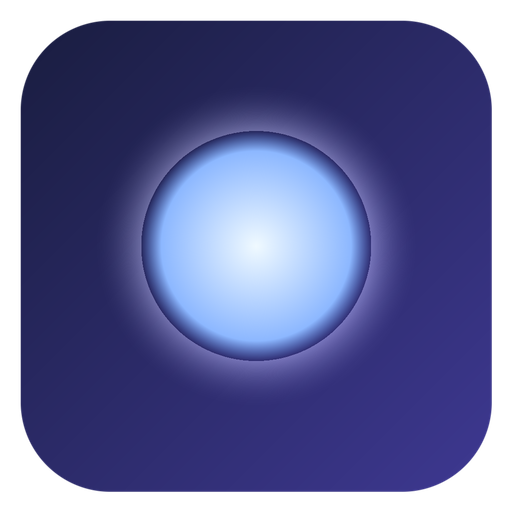
  <h1>Dayflit</h1>
  <p><b>A floating desktop productivity companion for Windows 10 and 11</b></p>
  <p>
    <a href="https://sidhu1512.github.io/dayflit/">Website</a> &bull;
    <a href="https://github.com/sidhu1512/dayflit/releases/latest">Download</a> &bull;
    <a href="#features">Features</a> &bull;
    <a href="#screenshots">Screenshots</a> &bull;
    <a href="#shortcuts">Shortcuts</a> &bull;
    <a href="#building-from-source">Build</a>
  </p>

  <p>
    <a href="https://sidhu1512.github.io/dayflit/"></a>
    <a href="https://github.com/sidhu1512/dayflit/releases/tag/v1.0.0"></a>
    <a href="https://github.com/sidhu1512/dayflit"></a>
    <a href="https://tauri.app"></a>
    <a href="LICENSE"></a>
  </p>
</div>

<p align="center">
  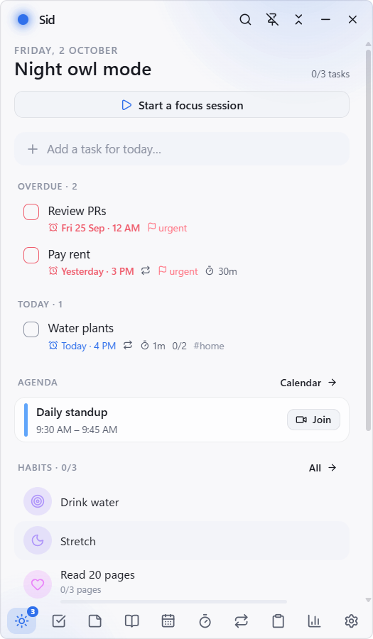
</p>

Dayflit is a floating desktop companion designed for Windows. It provides natural language task capture, Pomodoro focus sessions with ambient audio, calendar timeboxing, Markdown notes, private journaling, habit tracking, and clipboard history in a translucent interface that is always a keystroke away.

Dayflit operates 100% offline with local JSON storage, atomic file writes, and zero telemetry.

Live Website: [https://sidhu1512.github.io/dayflit/](https://sidhu1512.github.io/dayflit/)

---

## Downloads

Dayflit runs natively on 64-bit Windows 10 and Windows 11.

| Package | File | Size | Description |
| :--- | :--- | :--- | :--- |
| **Windows Installer** | [DayFlit_1.0.0_x64-setup.exe](https://github.com/sidhu1512/dayflit/releases/download/v1.0.0/DayFlit_1.0.0_x64-setup.exe) | 3.9 MB | Standard NSIS installer with desktop shortcut and uninstaller |
| **Portable Binary** | [dayflit.exe](https://github.com/sidhu1512/dayflit/releases/download/v1.0.0/dayflit.exe) | 13.4 MB | Standalone executable, no installation needed |

### Verification
- Version: `1.0.0`
- SHA-256: `4b8af810d245beaf605f51b450d40334da325413b0206da0b99928fcb421ecbe`
- Release Page: [GitHub Releases v1.0.0](https://github.com/sidhu1512/dayflit/releases/tag/v1.0.0)

PowerShell checksum verification:
```powershell
Get-FileHash -Algorithm SHA256 DayFlit_1.0.0_x64-setup.exe
```

---

<a name="features"></a>
## Features

- **Natural Language Task Capture**: Quick capture via `Alt+Space` or `Ctrl+K`. Parses due dates, times, priority levels (`!urgent`, `!high`), project lists (`#work`), and recurrence rules automatically.
- **Focus and Pomodoro Sessions**: Rust-backed countdown timers that maintain sub-millisecond precision even when the window is hidden. Includes built-in ambient noise generators (rain, white noise, forest) and Spotify media integration.
- **Floating Picture-in-Picture & Bubble**: Dockable mini-player and tiny edge bubble mode for zero-distraction desktop presence while coding, writing, or researching.
- **Calendar Integration**: Read and visualize `.ics` feeds from Google Calendar, Outlook, and iCloud. Automatic detection and one-click launch for Zoom, Google Meet, Teams, and Webex meetings.
- **Markdown Notes & Offline Journal**: Distraction-free notes with code syntax highlighting, checklists, and local image attachments. Private journal entries with mood rating (1-5) and optional PIN protection.
- **Habit Tracking & Streaks**: Flexible cadence schedules (daily, weekly, or specific weekdays) with 90-day visual consistency heatmaps.
- **Global Command Palette**: Instant fuzzy search across tasks, notes, habits, settings, and navigation destinations powered by Fuse.js.
- **Offline Voice Memos**: Global `Alt+Shift+V` shortcut to record audio notes locally.
- **Local-First Architecture**: Human-readable JSON files with atomic writes and automated `.bak` snapshot recovery. Zero cloud lock-in.

---

<a name="screenshots"></a>
## Screenshots

<table>
  <tr>
    <td width="50%" align="center">
      <b>Today View (Light)</b><br/>
      
    </td>
    <td width="50%" align="center">
      <b>Today View (Dark)</b><br/>
      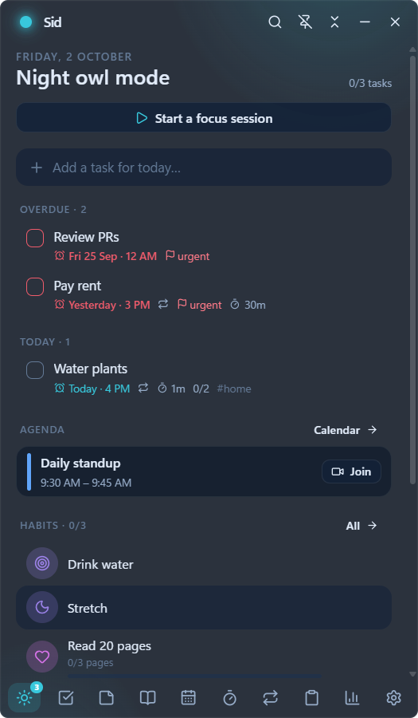
    </td>
  </tr>
  <tr>
    <td width="50%" align="center">
      <b>Task Management & Subtasks</b><br/>
      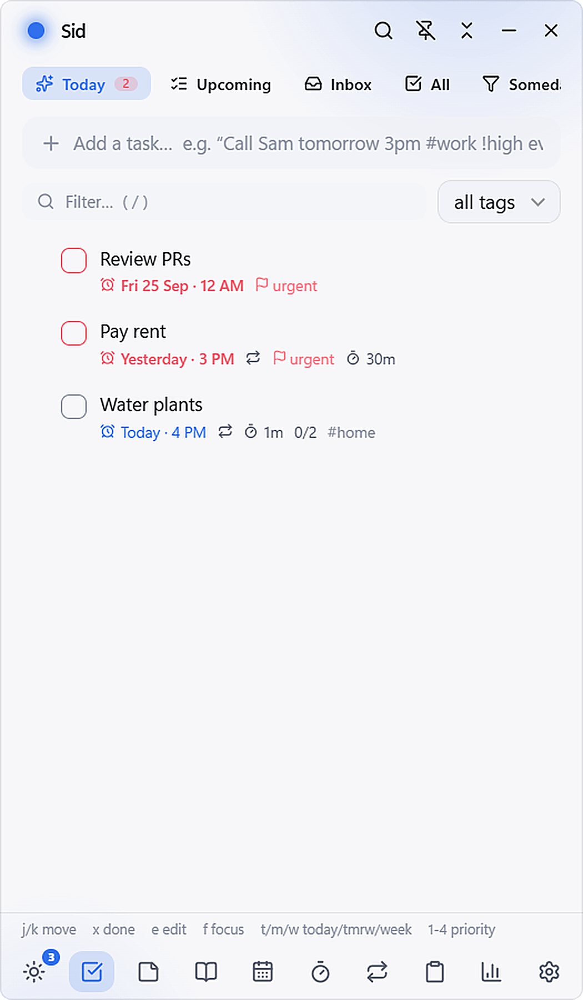
    </td>
    <td width="50%" align="center">
      <b>Focus & Pomodoro Timer</b><br/>
      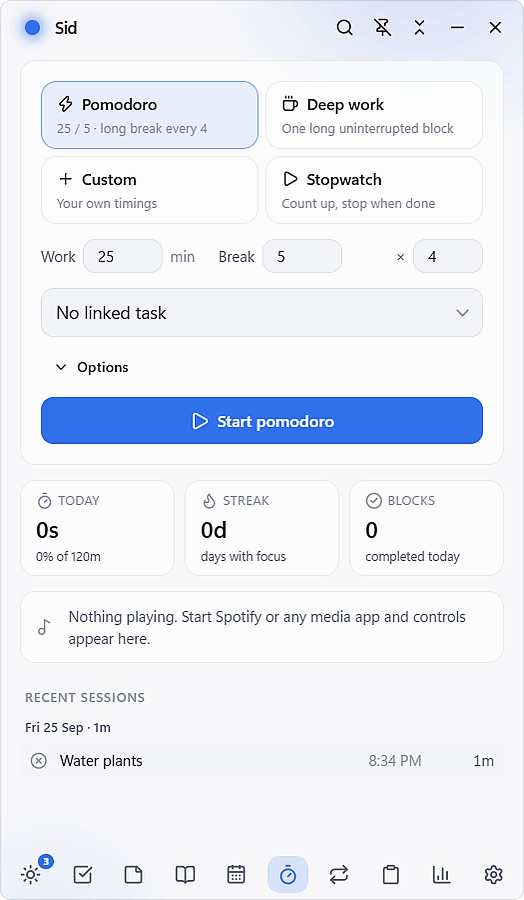
    </td>
  </tr>
  <tr>
    <td width="50%" align="center">
      <b>Floating Picture-in-Picture Tray</b><br/>
      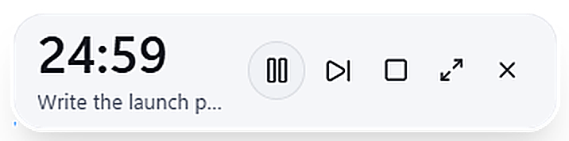
    </td>
    <td width="50%" align="center">
      <b>Micro-Bubble Mode</b><br/>
      
    </td>
  </tr>
  <tr>
    <td width="50%" align="center">
      <b>Calendar Timeboxing & Meetings</b><br/>
      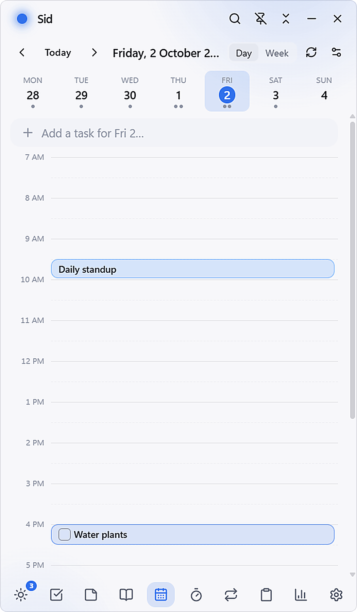
    </td>
    <td width="50%" align="center">
      <b>Private Offline Journal</b><br/>
      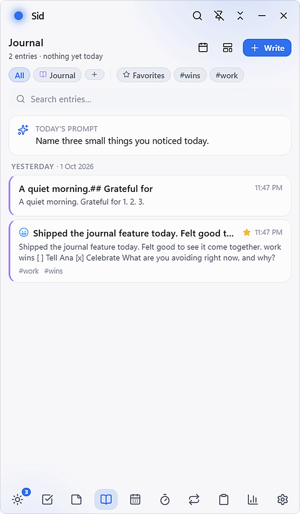
    </td>
  </tr>
  <tr>
    <td width="50%" align="center">
      <b>Habit Streaks & Heatmap</b><br/>
      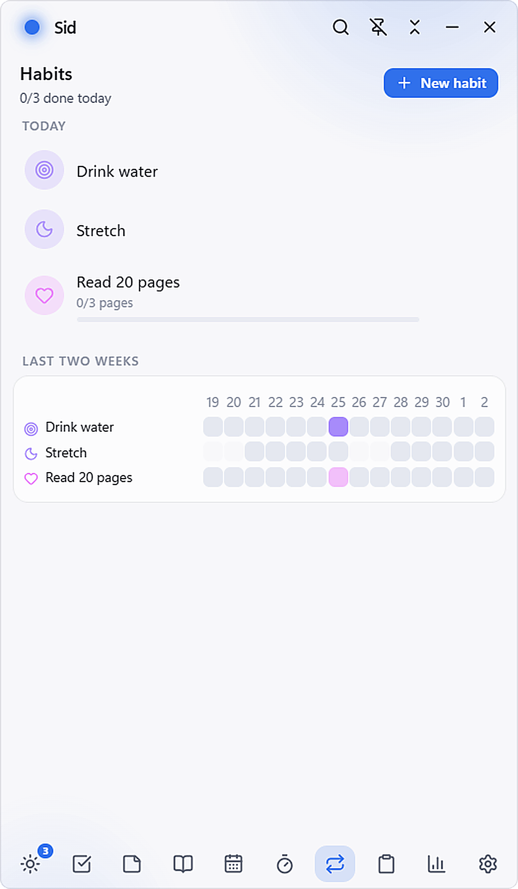
    </td>
    <td width="50%" align="center">
      <b>Command Palette Fuzzy Search</b><br/>
      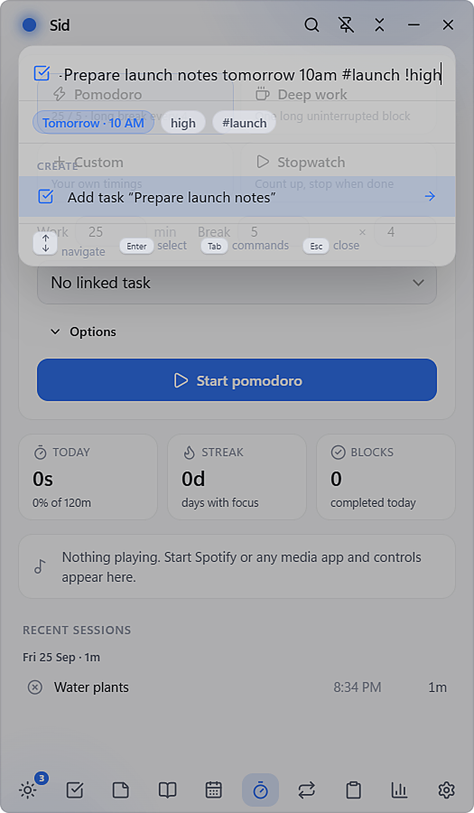
    </td>
  </tr>
  <tr>
    <td width="50%" align="center">
      <b>Productivity Insights</b><br/>
      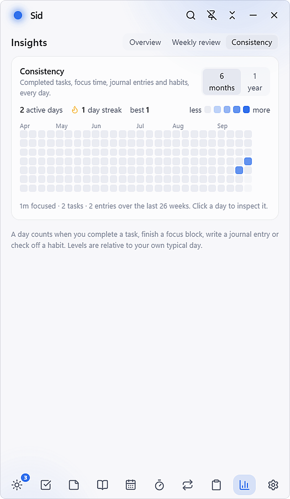
    </td>
    <td width="50%" align="center">
      <b>Offline Voice Recording</b><br/>
      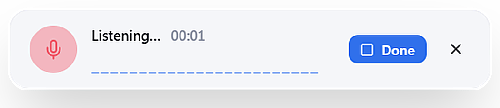
    </td>
  </tr>
</table>

---

<a name="shortcuts"></a>
## Keyboard Shortcuts

| Shortcut | Context | Function |
| :--- | :--- | :--- |
| `Alt+Space` | Global | Toggle main Dayflit floating window |
| `Ctrl+K` | Global / App | Open Command Palette search |
| `Alt+Shift+V` | Global | Start / stop offline voice memo recording |
| `j` / `k` | Lists | Navigate down / up |
| `x` | Tasks | Mark task complete or incomplete |
| `e` | Tasks / Notes | Edit highlighted item |
| `f` | Tasks | Start focus session on selected task |
| `n` | Lists | Create new entry |
| `1` - `9` | Navigation | Switch views directly |
| `Esc` | Anywhere | Minimize window or collapse to bubble |

---

## Data Privacy and Storage

- **Data Path**: User data is saved to `%APPDATA%\Dayflit\data\` by default.
- **Safety**: Writes are atomic (temporary file write followed by atomic rename) to guard against sudden power loss or process termination.
- **Backups**: Daily `.bak` snapshots are created automatically in the data directory.
- **Export**: One-click Markdown export compatible with Obsidian, Logseq, and plain text tools.

---

<a name="building-from-source"></a>
## Building from Source

### Prerequisites
- Node.js 20+
- Rust stable (MSVC toolchain)
- WebView2 Runtime (bundled with Windows 10 and 11)

### Setup

```bash
# 1. Clone repository
git clone https://github.com/sidhu1512/dayflit.git
cd dayflit

# 2. Install dependencies
npm install

# 3. Run development build
npm run tauri dev

# 4. Run test suite (266 tests across 20 suites)
npm test

# 5. Typecheck
npm run typecheck

# 6. Build production installer
npm run tauri build
```

Production NSIS installer will be located in `src-tauri/target/release/bundle/nsis/`.

---

## License

This project is licensed under the [MIT License](LICENSE).
